# Pertemuan 10: Input Data ke Database

Form Swing **Anggota** (praktikum) dan **Buku** (tugas mandiri) menyimpan data ke MariaDB lewat DAO. Keduanya dibuka dari panel JavaFX yang juga menampilkan isi tabel.

## Struktur kode

| Lokasi di `src/main/java/sem3matkul/pertemuan10` | Isi |
| --- | --- |
| `koneksi/KoneksiDB.java` | Koneksi database dan pembuatan tabel |
| `model/Anggota.java`, `model/Buku.java` | Model data |
| `dao/AnggotaDAO.java`, `dao/BukuDAO.java` | Query simpan, cek duplikat, dan tampil data |
| `swing/FormAnggota.java`, `swing/FormBuku.java` | Form input Swing |
| `controller/InputDataController.java` | Panel JavaFX (`resources/sem3matkul/pertemuan10/input_data.fxml`) |

## Menjalankan dengan Nix di Gentoo

Sekali saja, buat `/nix` lalu pasang Nix mode single-user:

```bash
sudo install -d -m 0755 -o "$USER" -g "$USER" /nix
sh <(curl -L https://nixos.org/nix/install) --no-daemon
. ~/.nix-profile/etc/profile.d/nix.sh
```

Pastikan MariaDB berjalan dan database sudah ada:

```bash
mariadb -e 'CREATE DATABASE IF NOT EXISTS perpustakaan CHARACTER SET utf8mb4;'
```

Jalankan aplikasi dari root project, dengan `echo 2` untuk memilih mode GUI:

```bash
echo 2 | nix-shell -p jdk21 gradle --run 'export JAVA_HOME=$(dirname $(dirname $(readlink -f $(which java)))); nix-shell shell.nix --run "gradle run"'
```

Bila dijalankan lewat SSH, tambahkan dulu akses ke layar desktop:

```bash
export DISPLAY=:0 XAUTHORITY=/run/user/$(id -u)/gdm/Xauthority
```

`JAVA_HOME` wajib diarahkan ke JDK Nix. Tanpa itu Gradle memakai JDK 25 Gentoo bersama library GTK dari Nix, dan JavaFX berhenti dengan `UnsupportedOperationException: Internal Error`.

## Hasil pengujian

Verifikasi otomatis `gradle testPertemuan10GUI` lulus. Pengujian berikut dijalankan pada aplikasi di layar desktop.

| Pengujian | Hasil |
| --- | --- |
| ID atau Nama kosong | Muncul peringatan, data tidak disimpan |
| Simpan Anggota `A001` | 1 baris masuk ke tabel `anggota`, form bersih, tabel JavaFX ter-refresh |
| ID `A001` diinput lagi | Muncul peringatan "sudah terdaftar" |
| No Telp `12ab` | Muncul peringatan format |
| Tombol Reset dan Keluar | Form bersih, jendela tertutup |
| Stok `abc` | Muncul peringatan format |
| Simpan Buku | 1 baris masuk ke tabel `buku`, tabel JavaFX ter-refresh |

### Dashboard dan panel JavaFX

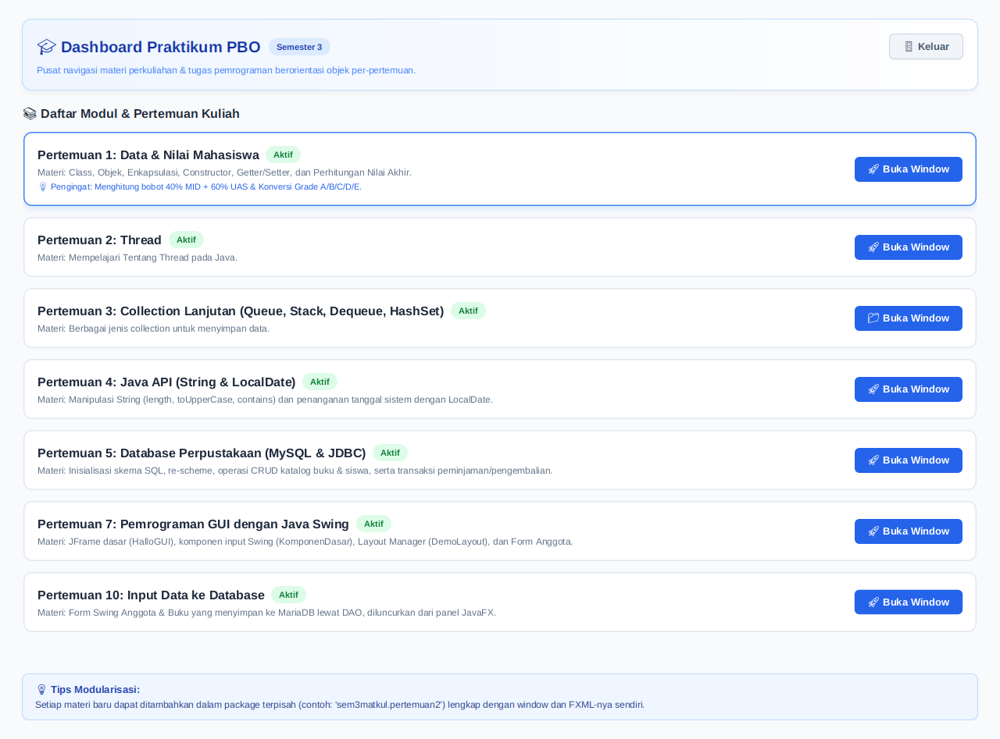

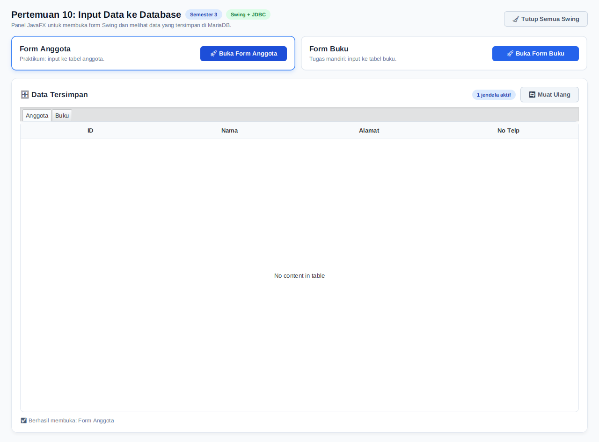

### Form Anggota

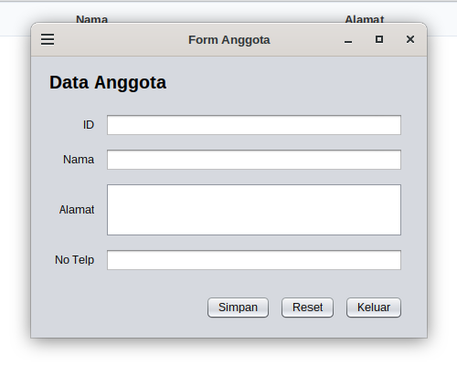

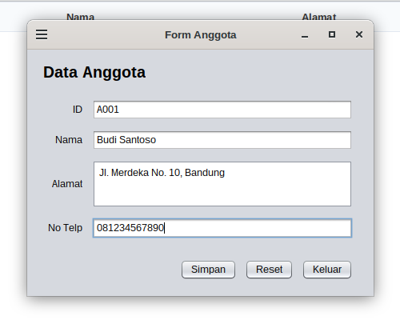

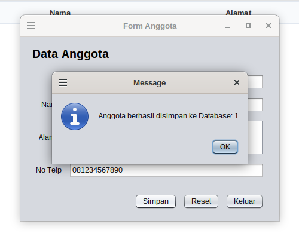

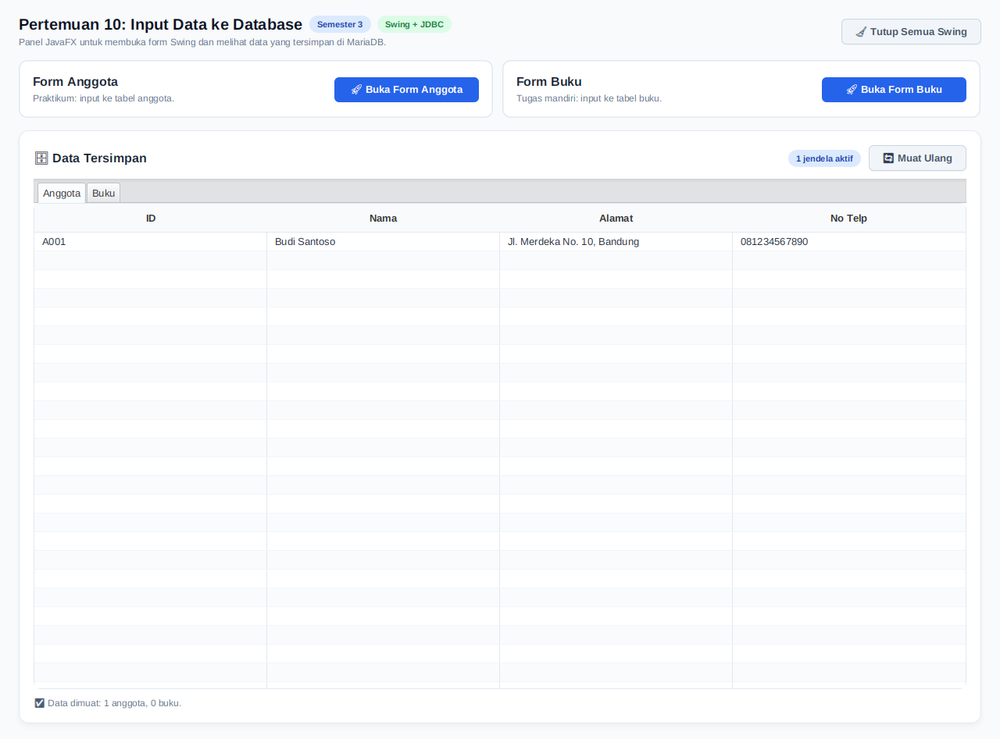

### Validasi Form Anggota

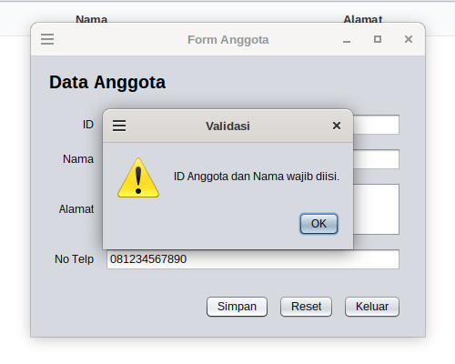

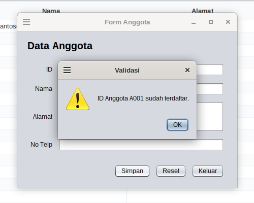

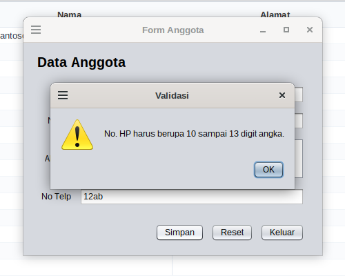

### Tugas Mandiri: Form Buku

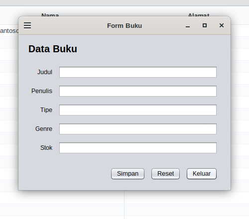

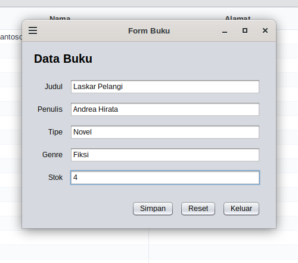

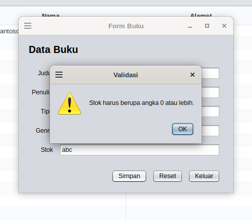

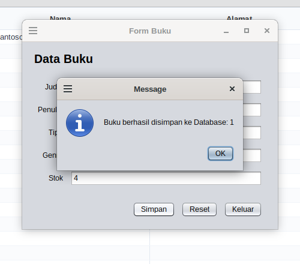

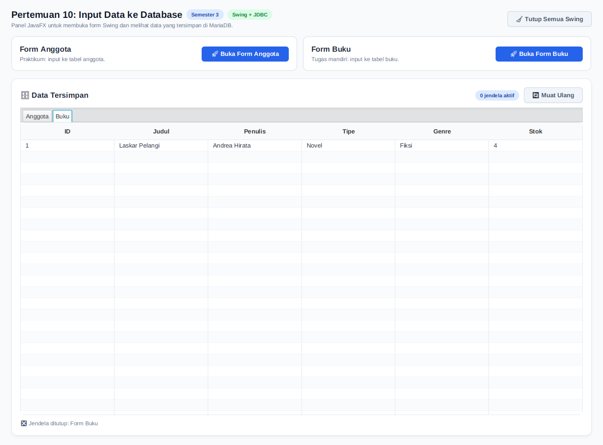

### Isi database setelah pengujian

```text
id_anggota  nama          alamat                       no_hp
A001        Budi Santoso  Jl. Merdeka No. 10, Bandung  081234567890

id  nama            penulis        tipe   genre  stok
1   Laskar Pelangi  Andrea Hirata  Novel  Fiksi  4
```
